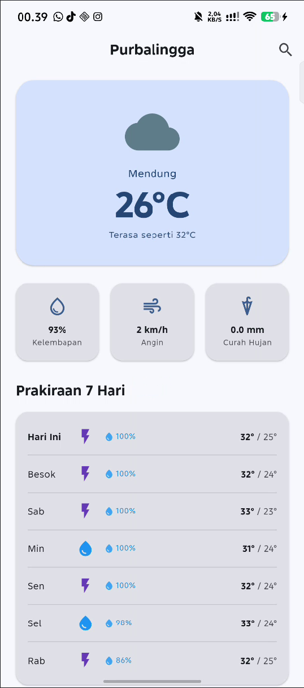
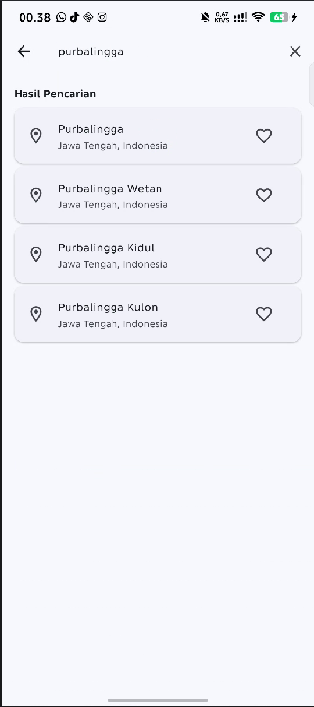

# Aplikasi Cuaca - Responsi Flutter

Aplikasi cuaca berbasis Flutter yang menampilkan informasi cuaca terkini dan prakiraan 7 hari ke depan menggunakan data real-time dari Open-Meteo API, serta mendukung pencarian kota dan penyimpanan lokasi favorit menggunakan SharedPreferences.

## Struktur Aplikasi

Aplikasi disusun menggunakan struktur folder yang terorganisir agar mudah dikembangkan dan dipelihara:

- lib/main.dart sebagai titik masuk utama aplikasi yang menginisialisasi SharedPreferences dan menjalankan GetMaterialApp.
- lib/core/ berisi konfigurasi umum, yaitu api_constants.dart untuk alamat dasar dan batas waktu request API, app_theme.dart untuk tema Material 3, serta weather_utils.dart untuk menerjemahkan kode cuaca WMO menjadi deskripsi, ikon, warna, dan nama hari.
- lib/data/models/ berisi model data weather_model.dart dan location_model.dart untuk mengolah data JSON dari API maupun penyimpanan lokal.
- lib/data/services/ berisi weather_service.dart dan geocoding_service.dart untuk melakukan HTTP GET request ke Open-Meteo API.
- lib/data/local/ berisi favorite_service.dart yang menggunakan SharedPreferences untuk menyimpan daftar lokasi favorit dan lokasi terakhir yang dibuka.
- lib/modules/home/ berisi home_controller.dart, home_view.dart, dan home_binding.dart untuk halaman utama cuaca.
- lib/modules/search/ berisi location_search_controller.dart, search_view.dart, dan search_binding.dart untuk halaman pencarian kota dan daftar favorit.
- lib/routes/ berisi app_routes.dart dan app_pages.dart untuk pengaturan navigasi antar halaman menggunakan GetX.

## Implementasi API

Aplikasi ini menggunakan dua layanan REST API dari Open-Meteo dengan metode HTTP GET melalui package http:

1. Weather Forecast API (https://api.open-meteo.com/v1/forecast) digunakan untuk mengambil data cuaca berdasarkan parameter latitude, longitude, current, daily, dan timezone=auto. Data cuaca terkini yang ditampilkan meliputi suhu (temperature_2m), kelembapan (relative_humidity_2m), suhu terasa (apparent_temperature), curah hujan (precipitation), kode kondisi cuaca (weather_code), dan kecepatan angin (wind_speed_10m). Sedangkan data harian yang ditampilkan meliputi suhu maksimum (temperature_2m_max), suhu minimum (temperature_2m_min), peluang hujan maksimum (precipitation_probability_max), dan kode kondisi cuaca.
2. Geocoding API (https://geocoding-api.open-meteo.com/v1/search) digunakan pada fitur pencarian lokasi untuk mencari daftar kota berdasarkan kata kunci nama kota yang diketik pengguna.

Setiap respons JSON dari API diubah menjadi objek Dart melalui method fromJson pada masing-masing model, dan kondisi loading, data kosong, maupun error ditangani agar pengguna tetap mendapat informasi yang jelas.

## Penerapan MVVM

Aplikasi ini menerapkan pola arsitektur Model-View-ViewModel (MVVM) dengan bantuan state management GetX:

- Model diwakili oleh file di dalam lib/data/models/ serta service di lib/data/services/ dan lib/data/local/. Bagian ini bertugas mendefinisikan struktur data dan mengambil atau menyimpan data dari API maupun SharedPreferences.
- View diwakili oleh home_view.dart dan search_view.dart. Bagian ini hanya bertugas menampilkan antarmuka pengguna dan merespons perubahan state secara reaktif menggunakan Obx tanpa menyimpan logika bisnis.
- ViewModel diwakili oleh home_controller.dart dan location_search_controller.dart yang merupakan turunan GetxController. Bagian ini menjadi penghubung antara Model dan View dengan mengelola state reaktif (.obs), memanggil service API atau penyimpanan lokal, serta meneruskan data siap tampil ke View.

## Screenshot Aplikasi

### Home / Weather Screen

### Search / Location Screen

